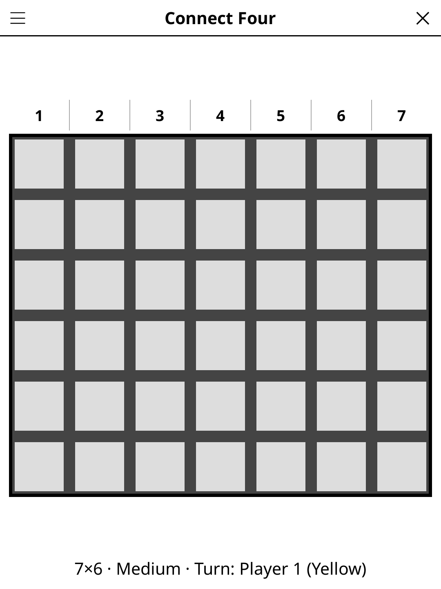

# connect4.koplugin

A Connect Four (Puissance 4) plugin for [KOReader](https://github.com/koreader/koreader).

## Screenshot

## Rules

Two players alternate dropping pieces into a 7×6 grid. Pieces fall to the lowest empty row in the chosen column. The first player to connect **four in a row** — horizontal, vertical, or diagonal — wins. A full board with no winner is a draw.

## Features

- **Two-player local mode**
- **AI opponent, three levels** — Easy looks two moves ahead and often picks a weaker column, Medium looks four moves ahead with a little variety, Hard looks seven moves ahead (at most ~2 s per move on an e-reader); every level takes a winning move and blocks yours, and Easy and Medium do not play the same game twice
- **Win detection** — the four winning pieces are highlighted
- **Undo** — remove the last dropped piece
- **New game** — reset the board at any time
- **Auto-save** — game state saved and restored on next launch

## Installation

1. Download `connect4.koplugin.zip` from the [latest release](../../releases/latest).
2. Extract into the `plugins/` folder of your KOReader data directory.
3. Restart KOReader.
4. Open the menu → **Tools** → **Connect Four**.

## Controls

| Action | How |
|--------|-----|
| Drop a piece | Tap a column |
| New game | Tap **New game** |
| Show rules | Tap **Rules** |

## License

GPL-3.0 — see [LICENSE](LICENSE).
